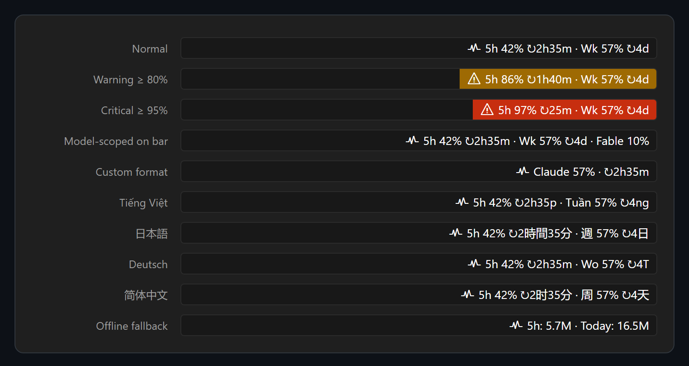
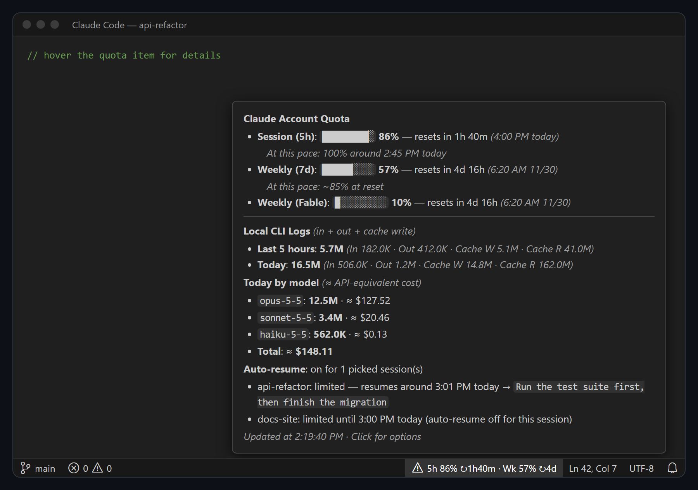
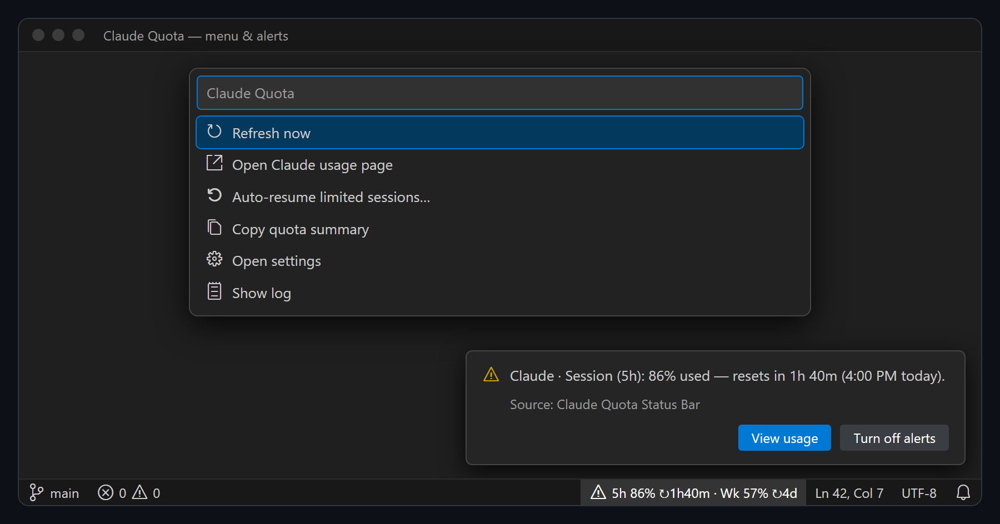
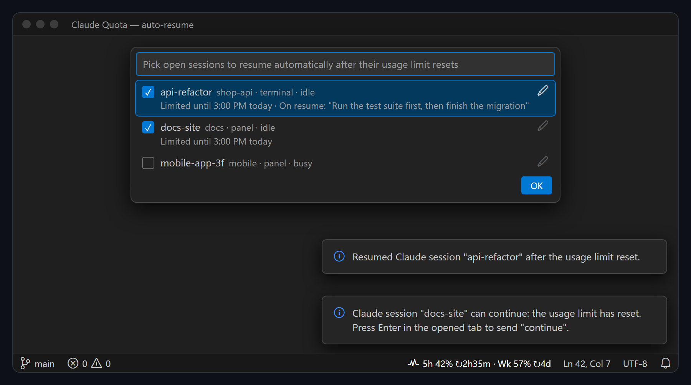
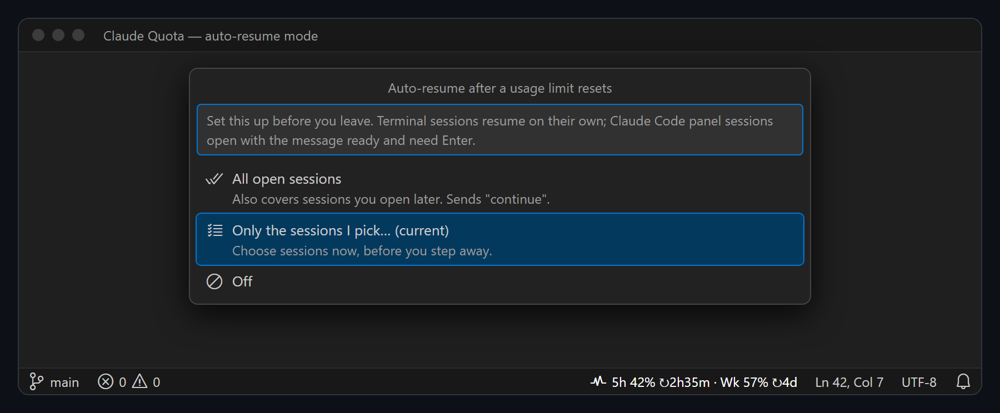

# Claude Quota Status Bar

Real-time **5-hour session**, **7-day weekly**, and **model-scoped (e.g. Fable)** Claude subscription quota percentages with reset countdowns right on your VS Code / Cursor / Windsurf / Antigravity status bar. It also forecasts your burn rate, alerts you before you run out, and can resume Claude Code sessions that stopped on a usage limit.

*(Bản hướng dẫn Tiếng Việt ở bên dưới)*

---

## Features

- **Real-time subscription percentages**: rolling **5-hour session** and **7-day weekly** usage with reset countdowns, e.g. `5h 42% ↻2h35m · Wk 57% ↻4d`. The item turns yellow at the warning threshold (`80%`) and red at the critical threshold (`95%`).
- **Rich hover tooltip**: progress bars for **Session (5h)**, **Weekly (7d)** and **model-scoped buckets (e.g. Fable)**, exact reset times, plus local `.jsonl` token stats for the last 5 hours and today.
- **Burn-rate forecast**: from recent samples, the tooltip tells you when you will hit 100% at the current pace, or where you will land at reset.
- **Per-model usage and cost estimate**: today's local tokens per model (Opus, Sonnet, Haiku, Fable…) with an approximate API-equivalent cost, including 5-minute and 1-hour cache writes.

- **Threshold alerts**: one notification per reset window when a quota crosses the warning or critical threshold, with shortcuts to the Claude usage page or to turn alerts off.
- **Quick menu**: click the item to refresh, open the Claude usage page, manage auto-resume, copy a plain-text quota summary, open settings or show the log. Set `claudeQuota.clickAction` to `"refresh"` for the old one-click refresh.

- **Auto-resume limited sessions**: when an **open** Claude Code session stops with *"You've hit your session limit"*, the extension resumes it once the limit resets. Turn it on for every session or only for the sessions you pick. [Details below](#auto-resume-limited-sessions).

- **Custom status bar format**: a template such as `{icon} Claude {max}% · ↻{sessionReset}`.
- **10 languages**: English, Tiếng Việt, 简体中文, 日本語, 한국어, Español, Português (Brasil), Français, Deutsch and Русский. The language is detected automatically or set in Settings; reset times follow the locale's date and time format.
- **Cross-platform OAuth support**:
  - **Windows & Linux / WSL**: reads existing Claude Code credentials from `~/.claude/.credentials.json` (respects `CLAUDE_CONFIG_DIR`).
  - **macOS**: reads the **macOS Keychain** item `Claude Code-credentials`, falling back to the dotfile.
- **Multi-window rate-limit protection**: all editor windows share one atomic cache (`~/.claude/usage-statusbar-cache.json`) with a fetch lock and `Retry-After` backoff on `HTTP 429`. When offline, the item falls back to local log token counts.
- **Lightweight**: local logs are read incrementally (only new bytes since the last scan) and asynchronously, so the editor stays responsive with large histories.
- **Diagnostics**: the **Claude Quota** output channel (`Claude Quota: Show Log`) records HTTP status codes and backoff decisions, never tokens.

## Auto-resume limited sessions

### Set it up before you step away

Auto-resume runs while you are away from the machine, so configure it beforehand:

1. Click the quota item → **Auto-resume limited sessions…** (or run **Claude Quota: Auto-resume Limited Sessions…**).
2. Choose one option:
   - **All open sessions**: every open session in the workspace, including ones opened later.
   - **Only the sessions I pick…**: tick sessions and press OK. Optionally click ✎ on a session to send it a custom message instead of `continue`.
   - **Off**.
3. Hover the quota item to confirm it is armed: the tooltip shows *Auto-resume: on for all open sessions* or *on for N picked session(s)*.

**While you are away, keep:** the VS Code window open (the extension runs inside it) and the computer awake (no sleep or hibernate).

> **Fully unattended only in the terminal.** Sessions started with `claude` in a VS Code terminal are resumed with no action needed. Sessions in the Claude Code **panel** open with the message filled in but still need you to press **Enter**, because the panel has no public API for sending a prompt. For long tasks you will leave running, start them in the terminal.

### How it works

Claude Code writes a structured `usage_limit_reached` record to the session transcript when a session hits its limit. The extension:

1. Lists Claude Code sessions that are **still running** (`~/.claude/sessions/*.json` whose process is alive) and whose working folder belongs to the current VS Code window.
2. Marks a session as *limited* when the last message in its transcript is that limit record (nothing has been sent since).
3. After the reset time plus `claudeQuota.autoResumeDelaySeconds`, once the session is idle and the live quota is no longer at 100%, resumes it **once** with its resume message.

**Resume messages.** By default a resumed session just receives `continue`; tick the sessions and press OK. Optionally, click the ✎ button next to a session to give it its own message, for example *"Re-run the failing tests first, then finish the migration"*. Leave it empty to go back to `continue`. Custom messages show in the picker and the tooltip. Terminal sessions get them as a single line, because the Claude CLI sends on newline.

How a session is resumed depends on where it runs:

| Where the session runs | What happens |
| :--- | :--- |
| Claude CLI in a VS Code terminal | The message is typed into that terminal and sent automatically. |
| Claude Code extension panel | The session tab opens with the message pre-filled; press **Enter** to send it. The Claude Code panel has no public API for sending a prompt, so this step stays manual. |

Choose the scope with `claudeQuota.autoResume`:

- `"selected"` (default): only sessions you pick in **Claude Quota: Auto-resume Limited Sessions…** (also in the quick menu).
- `"all"`: every open session in the workspace.
- `"off"`: never.

## Privacy & Security

- **Zero telemetry, zero third-party servers**: your OAuth access token is read only in memory on your machine and sent **only** over HTTPS to `https://api.anthropic.com/api/oauth/usage`.
- **Never logged or persisted**: tokens never appear in logs, tooltips or error messages, and are never written to the shared cache files (which hold percentages and timestamps only, with `0600` permissions).
- **Read-only credential handling**: the extension never changes or rotates your `.credentials.json` or Keychain entry, so it cannot race the Claude Code CLI's token refresh.
- **Local-only session handling**: auto-resume reads local session files and acts only through the VS Code terminal API and the Claude Code extension's own commands.

> **Disclaimer**: This is an independent, unofficial community extension and is **not** affiliated with, endorsed by, or supported by Anthropic. It queries an internal OAuth usage endpoint and reads Claude Code's local session files, whose format or rate limits may change at any time. Cost figures are estimates at public API prices, not your subscription bill.

## Requirements

- An active **Claude Pro / Max / Team** subscription signed in via **Claude Code** (`claude login`).

## Extension Settings

| Setting | Default | Description |
| :--- | :--- | :--- |
| `claudeQuota.language` | `"auto"` | `"auto"`, `"en"`, `"vi"`, `"zh-cn"`, `"ja"`, `"ko"`, `"es"`, `"pt-br"`, `"fr"`, `"de"` or `"ru"`. |
| `claudeQuota.showScopedOnStatusBar` | `false` | Show model-scoped weekly quota (e.g. `Fable 10%`) on the status bar. |
| `claudeQuota.warningThreshold` | `80` | Percentage for the warning color and warning alert. |
| `claudeQuota.errorThreshold` | `95` | Percentage for the error color and critical alert. |
| `claudeQuota.notifications` | `true` | Alert once per reset window when a threshold is crossed. |
| `claudeQuota.refreshIntervalSeconds` | `60` | Shared API refresh interval across windows (`30`–`600`). |
| `claudeQuota.alignment` | `"right"` | Status bar alignment (`"right"` or `"left"`). |
| `claudeQuota.clickAction` | `"menu"` | `"menu"` opens the quick menu, `"refresh"` refreshes immediately. |
| `claudeQuota.statusBarFormat` | `""` | Custom template. Placeholders: `{icon}`, `{session}`, `{sessionReset}`, `{weekly}`, `{weeklyReset}`, `{scoped}`, `{max}`. |
| `claudeQuota.showCostEstimate` | `true` | Show today's per-model tokens and estimated API-equivalent cost in the tooltip. |
| `claudeQuota.hideWhenSignedOut` | `false` | Hide the item when Claude Code is not signed in. |
| `claudeQuota.autoResume` | `"selected"` | `"off"`, `"selected"` or `"all"` (see above). |
| `claudeQuota.autoResumeMessage` | `"continue"` | Default message sent when a session is resumed; can be overridden per session. |
| `claudeQuota.autoResumeDelaySeconds` | `60` | Extra wait after the reset time before resuming (`0`–`1800`). |

## Commands

- `Claude Quota: Refresh Now`
- `Claude Quota: Show Menu`
- `Claude Quota: Auto-resume Limited Sessions…`
- `Claude Quota: Show Log`

## Contributing translations

Runtime strings live in [`i18n/<lang>.json`](i18n) and Settings UI strings in `package.nls.<lang>.json`. To add a language, copy `i18n/en.json` and `package.nls.json`, translate the values (keep the `{0}` placeholders), add the code to `SUPPORTED_LANGS` in `extension.js` and to the `claudeQuota.language` enum in `package.json`, then run `npm test` (it checks every locale for missing keys and placeholders).

The README images are generated from the extension's own formatting code with `npm run screenshots` (needs Chrome or Edge).

---

## Tiếng Việt — Hạn mức Claude trên Thanh trạng thái

Tiện ích mã nguồn mở hiển thị **thời gian thực** phần trăm hạn mức **Phiên 5 giờ**, **Tuần 7 ngày** và **Mô hình phụ (như Fable)** kèm đếm ngược đặt lại ngay trên thanh trạng thái của **VS Code / Antigravity / Cursor / Windsurf**. Tiện ích còn dự báo tốc độ dùng, cảnh báo trước khi hết hạn mức và có thể tự tiếp tục các phiên Claude Code bị dừng do hết hạn mức.

### Điểm nổi bật
- **Hiển thị trực quan**: `5h 42% ↻2h35p · Tuần 57% ↻4ng`, tự đổi màu nền vàng khi chạm **80%** và đỏ khi chạm **95%**.
- **Bảng chú giải đầy đủ**: thanh tiến độ cho **Phiên (5 giờ)**, **Tuần (7 ngày)**, **Tuần (Fable)**, giờ đặt lại chính xác và thống kê nhật ký máy cục bộ.
- **Dự báo tốc độ dùng**: cho biết với tốc độ hiện tại khi nào sẽ chạm 100%, hoặc sẽ dùng khoảng bao nhiêu phần trăm khi đặt lại.
- **Thống kê theo mô hình kèm chi phí ước tính**: token hôm nay theo từng mô hình và chi phí quy đổi theo giá API (chỉ để tham khảo, không phải hóa đơn gói đăng ký).
- **Cảnh báo vượt ngưỡng**: thông báo một lần cho mỗi chu kỳ đặt lại khi vượt ngưỡng cảnh báo hoặc ngưỡng đỏ.
- **Menu nhanh khi bấm**: làm mới, mở trang mức sử dụng Claude, quản lý tự tiếp tục phiên, sao chép tóm tắt, mở cài đặt, xem nhật ký.
- **Tự tiếp tục phiên bị giới hạn**: khi một phiên Claude Code **đang mở** bị dừng vì *"You've hit your session limit"*, tiện ích tự tiếp tục phiên đó sau khi hạn mức đặt lại. Có thể bật cho mọi phiên hoặc chỉ các phiên bạn chọn.
  - Phiên chạy bằng CLI trong terminal của VS Code: tin nhắn (mặc định `continue`) được gõ và gửi tự động.
  - Phiên trong panel của extension Claude Code: tab phiên được mở với tin nhắn điền sẵn, bạn chỉ cần nhấn **Enter**, vì panel không có API công khai để gửi prompt.
  - **Cài đặt trước khi rời máy**: bấm vào mục hạn mức → **Tự tiếp tục các phiên bị giới hạn…** → chọn **Tất cả phiên đang mở** (gồm cả phiên mở sau này) hoặc **Chỉ các phiên tôi chọn…**. Rê chuột lên mục hạn mức để kiểm tra dòng *"Tự tiếp tục phiên: bật cho…"*. Khi vắng mặt, cần giữ cửa sổ VS Code mở và máy không ngủ.
  - **Chỉ tự động hoàn toàn với phiên chạy trong terminal**: phiên trong panel Claude Code vẫn cần nhấn Enter. Việc dài định để chạy qua đêm nên khởi động bằng lệnh `claude` trong terminal của VS Code.
  - **Dùng đơn giản**: chỉ cần tick phiên rồi bấm OK, khi tiếp tục sẽ gửi `continue`. Nếu muốn gửi kèm câu lệnh riêng, bấm nút ✎ cạnh phiên đó, ví dụ *"Chạy lại test đang lỗi trước, rồi làm tiếp phần migration"*. Để trống thì quay về `continue`.
  - Phạm vi chỉnh bằng `claudeQuota.autoResume`: `"selected"` (mặc định, chỉ các phiên chọn qua **Hạn mức Claude: Tự tiếp tục các phiên bị giới hạn…**), `"all"` (mọi phiên) hoặc `"off"` (tắt).
- **Mẫu hiển thị tùy chỉnh** và **10 ngôn ngữ** (Tiếng Việt, English, 简体中文, 日本語, 한국어, Español, Português, Français, Deutsch, Русский).
- **Đa hệ điều hành**: tự đọc phiên đăng nhập Claude Code sẵn có trên **Windows**, **Linux/WSL** (`~/.claude/.credentials.json`) và **macOS Keychain** (`Claude Code-credentials`).
- **Chống giới hạn lượt gọi (`HTTP 429`)**: đồng bộ bộ đệm giữa mọi cửa sổ VS Code đang mở, đọc nhật ký cục bộ tăng dần nên không làm chậm trình soạn thảo.
- **An toàn**: khóa xác thực chỉ đọc trong bộ nhớ và chỉ gửi tới `api.anthropic.com`, không qua máy chủ trung gian, không ghi ra nhật ký hay tệp bộ đệm.

### Cài đặt thủ công từ tệp `.vsix`
1. Tải tệp `claude-quota-statusbar-1.1.0.vsix` trong mục **Releases** trên GitHub.
2. Mở VS Code ➔ nhấn `Ctrl+Shift+P` (`Cmd+Shift+P` trên macOS) ➔ chọn **Extensions: Install from VSIX...** ➔ chọn tệp vừa tải.

## License

[MIT](./LICENSE) © Tran Hiep (Franky755)
